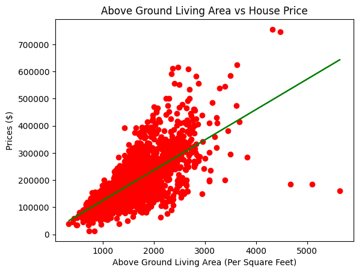
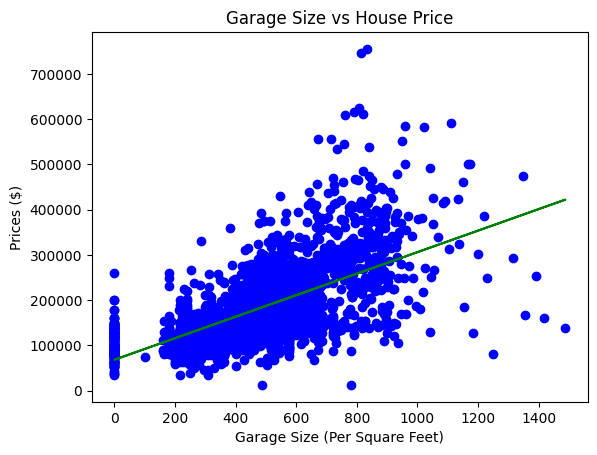
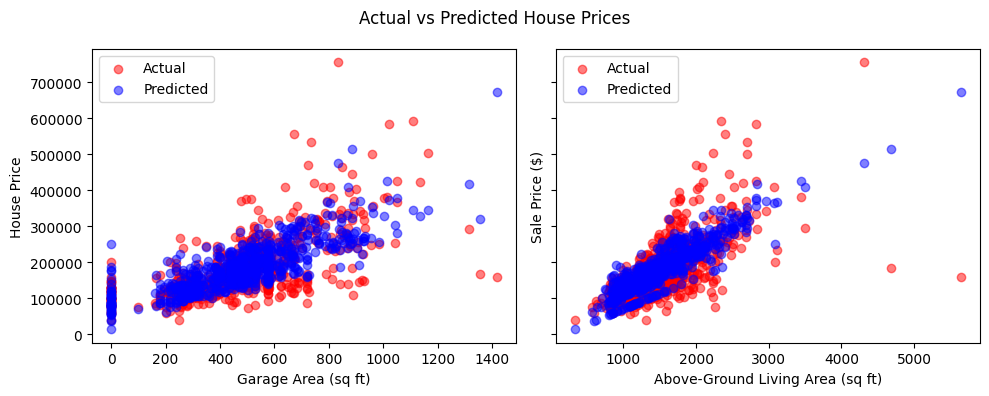

# Ames Housing Price Analysis & Prediction 

**Tools:** Python | Pandas | NumPy | Scikit-learn | Seaborn

## 📌 Project Overview 

This project explores how **garage area** and **above-ground living area** relate to residential
property prices in Ames, Iowa.

### Business Question 

> To what extent can property size characteristics explain and predict residential sale prices?

## 📊 Key Findings

| Metric | Result |
| ---|---:|
|R² Score | 0.5696 |
|RMSE | $53,247 |
|Garage Area Coefficient | +143.48|
|Above Ground Living Area Coefficient | +86.01|

**Interpretation:** The model explains approximately 57% of the variation in test-set sale 
prices.

# Exploratory Data Analysis

### Living Area vs Sale Price 

The simple linear regression illustrates the positive relationship between above-ground 
living area and property sales prices. 

### Garage Area vs Sale Price

The simple linear regression also illustrates a positive relationship between garage size
and property sale prices. 

## Actual vs Predicted Prices 

## Model Limitations
- Only two predictors were used.
- Property quality and location were not included.
- Prediction errors remain substantial.

## Project Files 

- [view Jupyter Notebook](Linear_Regression_Ames.ipynb)
- [View Dataset](ames.csv)

## Future Improvements 
- Compare performance against a baseline model
- Investigate additional property features
- Evaluate alternative transformations
